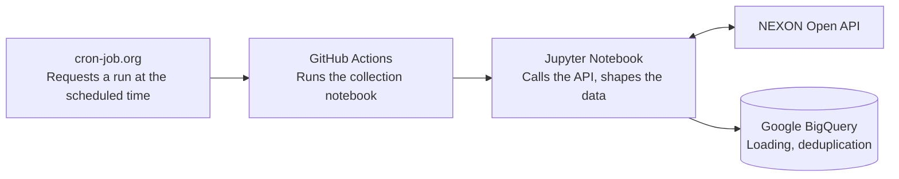

# NEXON Open API Game Trade Data Collection Pipeline

🌐 [한국어](README.md) | **English**

> A pipeline that automatically collects **Mabinogi auction house** and **Mabinogi Heroes marketplace and notice** data from the NEXON Open API at scheduled times and loads it into Google BigQuery.

**Data based on NEXON Open API** (https://openapi.nexon.com)

The collected raw data is not made public.

## 1. Purpose

- Game auction and marketplace APIs only provide data for [a recent window](#4-collected-data-and-schedule). The data is collected automatically on a fixed schedule so that none of it is missed.
- The pipeline runs at no cost without a dedicated server, using cron-job.org, GitHub Actions and Google BigQuery.

## 2. Tech stack

| Area | Technology |
|---|---|
| Collection | Python 3.13, `requests`, `pandas` |
| Execution | Jupyter Notebook, GitHub Actions (`nbconvert`) |
| Scheduling | cron-job.org |
| Loading and cleaning | Google BigQuery (`google-cloud-bigquery`, `pyarrow`) |
| Authentication | GitHub Secrets, GCP service account, GitHub fine-grained token |

## 3. Pipeline



| Component | Role |
|---|---|
| cron-job.org | Requests a workflow run from GitHub at the scheduled time. |
| GitHub Actions | Sets up the Python environment and runs the collection notebook. |
| Jupyter Notebook | Calls the NEXON Open API, collects the data and shapes it into tables. |
| Google BigQuery | Stores the collected data in tables and then removes duplicates. |

## 4. Collected data and schedule

| Game | Data | Endpoint | API window | Schedule (KST) |
|---|---|---|---|---|
| Mabinogi | Auction trade history | `/mabinogi/v1/auction/history` | Last 1 hour | Every 30 min (:00, :30) |
| Mabinogi Heroes | Enchant scroll prices | `/heroes/v2/marketplace/market-history` | Last 1 week | Daily 08:05 |
| Mabinogi Heroes | Top 30 gold buyers | `/heroes/v2/marketplace/gold-market-buy-top-30` | Last 1 week | Daily 08:05 |
| Mabinogi Heroes | Top 30 gold sellers | `/heroes/v2/marketplace/gold-market-sell-top-30` | Last 1 week | Daily 08:05 |
| Mabinogi Heroes | Notices | `/heroes/v1/notice` | Latest 20 | Daily 08:05 |
| Mabinogi Heroes | Patch notes | `/heroes/v1/notice-patch` | Latest 20 | Daily 08:05 |
| Mabinogi Heroes | Events & shop | `/heroes/v1/notice-event` | Latest 20 | Daily 08:05 |

### 4-1. Mabinogi auction house: reason for 30-minute intervals

- The auction trade history API only provides trades from the last hour.
- Each run fetches the last hour every 30 minutes, so consecutive collection windows overlap by 30 minutes. If one run is delayed or missed, the next run still collects that window.

### 4-2. Mabinogi Heroes: reason for daily collection at 08:05

- Item trade records are only returned for items traded 10 or more times in the last 24 hours. Daily collection makes the 24-hour windows continuous, so every item traded 10 or more times is captured without gaps.
- The three notice endpoints return the latest 20 posts rather than a time window. The NEXON Open API documentation also recommends real-time or at least daily collection.
- The run was first set up as a GitHub Actions scheduled run, but it started well after the scheduled time. To prevent these delays, the trigger was redesigned around cron-job.org, and the time was changed to 08:05 to match when GitHub Actions had actually run.

## 5. Reason for using cron-job.org

- The pipeline first used GitHub Actions scheduled runs (`schedule`), but delays and missed runs kept occurring on the new repository.
  - Mabinogi: only 2 of the 20 or so test runs scheduled every 30 minutes actually ran
  - Mabinogi Heroes: the 04:30 scheduled run started about 4 hours late
- Mabinogi auction trade history only covers the last hour, so if a run is delayed or missed, that hour's trades cannot be collected again. Repeated gaps make it impossible to guarantee that the data is complete. The runs were therefore switched to automatic execution at times set in cron-job.org.

cron-job.org requests a manual workflow run (`workflow_dispatch`) through the GitHub API at the scheduled time, so it is not affected by GitHub's scheduled-run queue.

## 6. Deduplication

The collection interval is shorter than the API window, so collection windows overlap and duplicates occur. Raw data is loaded as is and cleaned in BigQuery right after loading.

| Table | Deduplication key | When |
|---|---|---|
| `mabinogi.auction_history` | `auction_buy_id` (unique trade ID) | Once a day (03:00 run) |
| `mabinogi_heroes.enchant_price` | `date_update` + `item_name` + `item_option` | Every run (08:05) |
| `mabinogi_heroes.notice`, `notice_patch`, `notice_event` | `notice_id` | Every run (08:05) |
| `mabinogi_heroes.gold_buy_top30`, `gold_sell_top30` | Not deduplicated | Each day's ranking is kept as data |

- When rows share the same key, only the most recently collected row is kept (`ROW_NUMBER()`, `CREATE OR REPLACE TABLE`).
- Cleaning Mabinogi on every run would scan the whole table 48 times a day, so it is cleaned once a day.

## 7. Repository structure

```
nexon-api-collector/
├── .github/
│   └── workflows/
│       ├── mabinogi.yml             # Mabinogi auction collection workflow
│       └── mabinogi_heroes.yml      # Mabinogi Heroes marketplace and notice workflow
├── notebooks/
│   ├── mabinogi_collect.ipynb          # Mabinogi collection, loading, deduplication
│   └── mabinogi_heroes_collect.ipynb   # Mabinogi Heroes collection, loading, deduplication
├── requirements.txt
├── .gitignore                       # excludes .env and gcp-key.json
├── README.md
└── README.en.md
```
