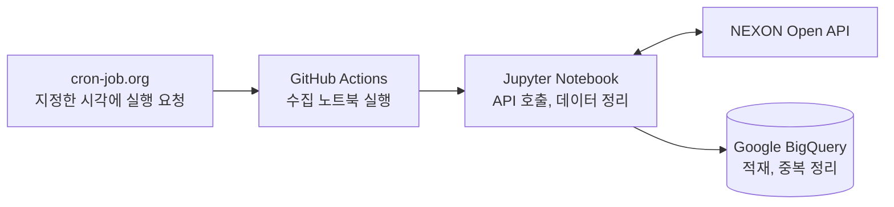

# NEXON Open API 게임 거래 데이터 수집 자동화 파이프라인

🌐 **한국어** | [English](README.en.md)

> 넥슨 Open API로 **마비노기 경매장**과 **마비노기 영웅전 거래소·공지** 데이터를 지정한 시각에 자동 수집하고, Google BigQuery에 적재하는 파이프라인입니다.

**Data based on NEXON Open API** (https://openapi.nexon.com)

수집한 원본 데이터는 공개하지 않습니다.

## 1. 프로젝트 목적

- 게임 경매장·거래소 API는 [최근 일부 기간](#4-수집-데이터와-주기)의 데이터만 제공합니다. 데이터를 누락 없이 확보하기 위해 정해진 주기로 자동 수집합니다.
- 별도 서버 없이 cron-job.org, GitHub Actions, Google BigQuery를 연결해 비용 없이 운영되는 수집 파이프라인을 구축했습니다.

## 2. 사용 기술

| 구분 | 기술 |
|---|---|
| 수집 | Python 3.13, `requests`, `pandas` |
| 실행 환경 | Jupyter Notebook, GitHub Actions (`nbconvert`) |
| 실행 예약 | cron-job.org |
| 적재·정리 | Google BigQuery (`google-cloud-bigquery`, `pyarrow`) |
| 인증 | GitHub Secrets, GCP 서비스 계정, GitHub Fine-grained 토큰 |

## 3. 파이프라인 구조

| 구성 요소 | 역할 |
|---|---|
| cron-job.org | 지정한 시각에 GitHub에 워크플로 실행을 요청합니다. |
| GitHub Actions | Python 환경을 준비하고 수집 노트북을 실행합니다. |
| Jupyter Notebook | 넥슨 Open API를 호출해 데이터를 수집하고 테이블 형태로 정리합니다. |
| Google BigQuery | 수집한 데이터를 테이블에 적재한 뒤 중복을 정리합니다. |

## 4. 수집 데이터와 주기

| 게임 | 데이터 | 엔드포인트 | API 제공 범위 | 수집 주기 (KST) |
|---|---|---|---|---|
| 마비노기 | 경매장 거래 내역 | `/mabinogi/v1/auction/history` | 최근 1시간 | 30분마다 (매시 00분, 30분) |
| 마비노기 영웅전 | 인챈트 스크롤 시세 | `/heroes/v2/marketplace/market-history` | 최근 1주 | 매일 08:05 |
| 마비노기 영웅전 | 골드 구매 상위 30명 | `/heroes/v2/marketplace/gold-market-buy-top-30` | 최근 1주 | 매일 08:05 |
| 마비노기 영웅전 | 골드 판매 상위 30명 | `/heroes/v2/marketplace/gold-market-sell-top-30` | 최근 1주 | 매일 08:05 |
| 마비노기 영웅전 | 공지사항 목록 | `/heroes/v1/notice` | 최근 20개 | 매일 08:05 |
| 마비노기 영웅전 | 패치노트 목록 | `/heroes/v1/notice-patch` | 최근 20개 | 매일 08:05 |
| 마비노기 영웅전 | 이벤트&샵 목록 | `/heroes/v1/notice-event` | 최근 20개 | 매일 08:05 |

### 4-1. 마비노기 경매장: 30분 간격 수집 이유

- 경매장 거래 내역 API는 최근 1시간의 거래만 제공합니다.
- 30분마다 최근 1시간을 조회하므로 연속된 수집 구간이 30분씩 겹칩니다. 한 번의 실행이 지연되거나 누락되어도 다음 실행이 해당 구간을 수집합니다.

### 4-2. 마비노기 영웅전: 하루 1회 08:05 수집 이유

- 아이템 거래 기록은 최근 24시간 동안 10건 이상 거래된 아이템만 조회됩니다. 하루 단위로 수집하면 24시간 구간이 빈틈없이 이어져, 10건 이상 거래된 아이템을 누락 없이 확보할 수 있습니다.
- 공지 3종은 기간이 아닌 최근 20개 기준으로 제공됩니다. 넥슨 Open API 문서에서도 실시간 조회 또는 최소 일 단위 수집을 권장합니다.
- 초기에는 GitHub Actions 예약 실행으로 설정했으나, 예약 시각보다 큰 지연이 발생했습니다. 이를 막기 위해 cron-job.org 기반으로 재설계하고, 앞서 GitHub Actions에서 실제 실행되었던 시각에 맞춰 08:05로 변경했습니다.

## 5. cron-job.org를 사용한 이유

- 초기에는 GitHub Actions 예약 실행(`schedule`)을 사용했으나, 신규 저장소에서 지연과 누락이 반복되었습니다.
  - 마비노기: 30분 간격으로 예정된 테스트 실행 20여 회 중 2회만 실행
  - 마비노기 영웅전: 04:30 예약 실행이 약 4시간 지연
- 마비노기 경매장 거래 내역은 최근 1시간만 제공하므로, 실행이 지연되거나 누락되면 해당 시간대의 거래를 다시 수집할 수 없습니다. 이러한 공백이 반복되면 데이터의 완전성을 보장할 수 없습니다. 이에 cron-job.org에서 실행 시각을 지정해 자동 실행되도록 변경했습니다.

cron-job.org는 지정한 시각에 GitHub API로 워크플로 수동 실행(`workflow_dispatch`)을 요청하므로, GitHub 예약 실행 대기열의 영향을 받지 않습니다.

## 6. 중복 처리

수집 주기가 API 제공 범위보다 짧아 수집 구간이 겹치므로 중복이 발생합니다. 원본은 그대로 적재하고, 적재 직후 BigQuery에서 중복을 정리합니다.

| 테이블 | 중복 기준 | 정리 시점 |
|---|---|---|
| `mabinogi.auction_history` | `auction_buy_id` (거래 고유 번호) | 하루 1회 (03:00 실행) |
| `mabinogi_heroes.enchant_price` | `date_update` + `item_name` + `item_option` | 매 실행 (08:05) |
| `mabinogi_heroes.notice`, `notice_patch`, `notice_event` | `notice_id` | 매 실행 (08:05) |
| `mabinogi_heroes.gold_buy_top30`, `gold_sell_top30` | 정리하지 않음 | 날짜별 순위 자체를 데이터로 보관 |

- 중복 기준이 같은 행은 가장 최근에 수집한 행만 남깁니다 (`ROW_NUMBER()`, `CREATE OR REPLACE TABLE`).
- 마비노기는 매 실행마다 정리하면 하루 48회 테이블 전체를 조회하게 되므로, 하루 1회만 정리합니다.